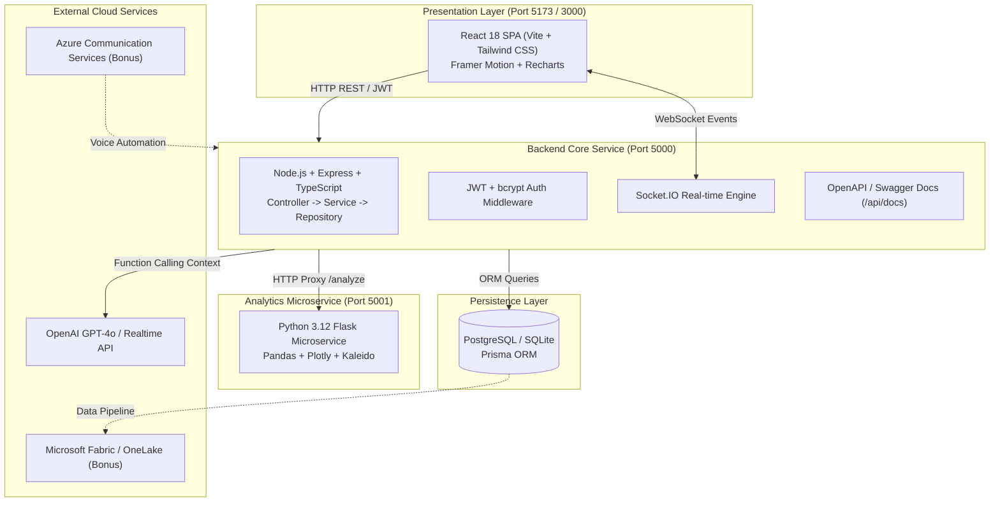

# 🚀 RBHU Enterprise Operations Management Platform
### Full Stack Engineer Technical Assessment

[](https://www.typescriptlang.org/)
[](https://react.dev/)
[](https://nodejs.org/)
[](https://www.python.org/)
[](https://www.postgresql.org/)
[](https://www.docker.com/)
[](LICENSE)

**Developer:** Yogesh Ghanshyam Shilawat  
**Initials / Avatar:** `YS`  
**Organization:** RBHU ETG Private Limited  
**Role:** Full Stack Developer – Assessment Project  

> ⚠️ **Assessment Project Disclaimer:**  
> This software is an independent engineering demonstration created by **Yogesh Ghanshyam Shilawat** for the **RBHU ETG Private Limited Full Stack Engineer Technical Assessment**. It is designed to demonstrate professional software engineering standards, microservices design, dark-theme UI/UX, AI copilot grounding, and cloud readiness. It is not an official commercial product or internal production system of RBHU ETG Private Limited.

---

## 📋 Executive Summary

The **RBHU Enterprise Operations Management Platform** is a full-stack, distributed SaaS solution built for modern logistics management, customer relationship management, high-concurrency shipment tracking, executive analytics, and database-grounded AI conversational assistance.

The application features:
1. **Node.js/Express TypeScript Core API** with Prisma ORM, JWT authentication, and strict Zod validation.
2. **React 18 Vite Dark-Theme SPA** with Framer Motion page transitions, collapsible animated sidebar, and Recharts interactive visualizations.
3. **Python 3.12 Flask Microservice** powering Pandas aggregation and Kaleido headless PNG chart generation.
4. **AI Operations Copilot** integrating OpenAI with real-time relational database grounding and conversation persistence.
5. **Real-time Event Broadcasting** via Socket.IO for live shipment status milestones.
6. **Enterprise Cloud Readiness** with comprehensive architecture blueprints for Azure App Service, Microsoft Fabric / OneLake, and Voice AI agents.

---

## 🏛️ System Architecture



---

## 🛠️ Technology Stack

| Layer | Technologies |
|---|---|
| **Frontend** | React 18, TypeScript, Vite, Tailwind CSS, Framer Motion, Lucide React, Recharts, Axios, Socket.IO Client |
| **Backend Core** | Node.js, Express.js, TypeScript, Prisma ORM, Zod, JWT, bcrypt, Winston/Pino logger |
| **Database** | PostgreSQL (Production) / SQLite (Zero-config Dev), Prisma Client & Migrations |
| **Analytics Service** | Python 3.12, Flask, Pandas, Plotly, Kaleido |
| **Real-time** | Socket.IO (WebSockets) |
| **AI Integration** | OpenAI API / Azure OpenAI with dynamic relational database grounding |
| **DevOps & Cloud** | Docker, Docker Compose, Nginx, GitHub Actions CI/CD, Azure App Service, Azure Key Vault |

---

## ✅ Assessment Modules Completion Status

| Module | Requirement | Status | Implementation Details |
|---|---|---|---|
| **Module 1** | Customer Management | ✅ Completed | Full CRUD, soft deletion (`isDeleted`), company search, status filtering, pagination |
| **Module 2** | Shipment Tracking | ✅ Completed | Status lifecycle (`Pending` → `Delivered`), history audit logs, tracking lookup |
| **Module 3** | Analytics Microservice | ✅ Completed | Python Flask, Pandas dataframes, regional breakdowns, Kaleido headless PNG export |
| **Module 4** | AI Operations Copilot | ✅ Completed | OpenAI integration, database grounding, conversation history, fallback demo mode |
| **Module 5** | Real-time WebSockets | ✅ Completed | Socket.IO status broadcasting, live toast alerts, notification counter updates |
| **Module 6** | Azure Cloud Architecture | ✅ Completed | Documented App Service, PostgreSQL Flexible Server, VNET, Key Vault, and CI/CD |
| **Bonus 1** | Microsoft Fabric / OneLake | ✅ Completed | Comprehensive architecture guide for OneLake delta tables and Direct Lake Power BI |
| **Bonus 2** | Voice Agent Architecture | ✅ Completed | Blueprint for Azure Communication Services + OpenAI Realtime Voice API |
| **Bonus 3** | SharePoint Intranet PoC | ✅ Completed | Corporate Announcements module with categories and mock SharePoint feed |
| **UI/UX** | Premium Dark Theme | ✅ Completed | Custom `#0B1020` palette, Framer Motion animations, glassmorphism, responsive |

---

## 🔑 Demo Credentials

The platform includes seed data with 3 predefined enterprise user roles:

| Role | Email | Password | Permissions |
|---|---|---|---|
| **Admin** | `admin@rbhu.in` | `Admin@123` | Full access: CRUD customers, shipments, analytics, AI, user management |
| **Operator** | `operator@rbhu.in` | `Operator@123` | Operational access: Dispatch shipments, update status, view customers |
| **Viewer** | `viewer@rbhu.in` | `Viewer@123` | Read-only access: View dashboard KPIs, track shipments, inspect reports |

---

## ⚡ Quick Start Guide

### Option 1: Docker Compose (Recommended)

Run all services (Frontend, Backend, Analytics Microservice, and PostgreSQL) with a single command:

```bash
# 1. Clone repository
git clone <repository-url>
cd "Rbhu Analytics"

# 2. Copy environment configuration
cp .env.example .env

# 3. Launch full stack
docker-compose up --build
```

**Access URLs:**
- **Frontend Application:** [http://localhost:3000](http://localhost:3000)
- **Backend API:** [http://localhost:5000](http://localhost:5000)
- **API Documentation (Swagger):** [http://localhost:5000/api/docs](http://localhost:5000/api/docs)
- **Analytics Microservice:** [http://localhost:5001](http://localhost:5001)

---

### Option 2: Local Development (Bare Metal)

#### Prerequisites
- Node.js 20+
- Python 3.10+
- npm or pnpm

#### 1. Setup Backend Core API
```bash
cd backend
npm install
cp .env.example .env

# Generate Prisma Client and seed database
npm run prisma:generate
npm run prisma:seed

# Start Node.js API server
npm run dev
# -> Server running on http://localhost:5000
```

#### 2. Setup Python Analytics Microservice (New Terminal)
```bash
cd analytics-service
python -m venv venv
# On Windows:
.\venv\Scripts\activate
# On Linux/macOS:
# source venv/bin/activate

pip install -r requirements.txt
python app.py
# -> Analytics service running on http://localhost:5001
```

#### 3. Setup React Frontend SPA (New Terminal)
```bash
cd frontend
npm install
npm run dev
# -> Vite dev server running on http://localhost:5173
```

---

## 🧪 Testing & Verification

Run automated test suites across all layers:

```bash
# 1. Backend Core API Unit & Integration Tests (Jest)
cd backend
npm test
# Result: 5/5 test suites passed

# 2. Python Analytics Microservice Tests (pytest)
cd analytics-service
python -m pytest tests/ -v
# Result: 7/7 test suites passed

# 3. Frontend Production Build & Typecheck
cd frontend
npm run build
# Result: 0 errors, minified production assets created
```

---

## 📂 Project Structure

```
rbhu-enterprise-platform/
│
├── frontend/                       # React 18 TypeScript SPA (Vite + Tailwind CSS)
│   ├── src/
│   │   ├── components/             # Reusable UI cards, tables, badges, modals
│   │   ├── layouts/                # AppLayout with Framer Motion collapsible sidebar
│   │   ├── pages/                  # 9 Enterprise Views (Dashboard, Shipments, etc.)
│   │   ├── context/                # AuthContext, NotificationContext (Socket.IO)
│   │   ├── services/               # Axios API abstraction
│   │   └── types/                  # TypeScript data interfaces
│   ├── Dockerfile                  # Multi-stage production Nginx container
│   └── package.json
│
├── backend/                        # Node.js + Express + TypeScript Core API
│   ├── src/
│   │   ├── controllers/            # Customer, Shipment, Chat, Analytics, Notifications
│   │   ├── services/               # Business logic and OpenAI grounding engine
│   │   ├── repositories/           # Prisma ORM data access layer
│   │   ├── routes/                 # Express routing with Zod validation
│   │   ├── middleware/             # JWT authentication and error handlers
│   │   ├── sockets/                # Socket.IO real-time event handlers
│   │   └── server.ts               # HTTP & WebSocket bootstrap
│   ├── prisma/
│   │   ├── schema.prisma           # PostgreSQL schema (Production)
│   │   ├── schema.sqlite.prisma    # SQLite schema (Local development)
│   │   └── seed.ts                 # 15 customers, 25 shipments, 3 users seed
│   ├── Dockerfile                  # Production Node.js container
│   └── package.json
│
├── analytics-service/              # Python 3.12 Flask Microservice
│   ├── app.py                      # Flask application entry point
│   ├── routes/                     # /analyze and /export endpoints
│   ├── services/                   # Pandas aggregation and Kaleido chart exports
│   ├── tests/                      # Pytest suite
│   ├── requirements.txt            # Python dependencies
│   └── Dockerfile                  # Production Python container
│
├── docs/                           # Enterprise Architecture Documentation
│   ├── ARCHITECTURE.md             # Microservices topology and lifecycle
│   ├── DATABASE_SCHEMA.md          # ERD diagram, table schemas, and indexing
│   ├── API_DOCUMENTATION.md        # REST API endpoints, schemas, curl samples
│   ├── AZURE_DEPLOYMENT.md         # Azure App Service, VNET, and Key Vault guide
│   ├── SECURITY.md                 # RBAC, bcrypt, JWT, and GDPR compliance
│   ├── FABRIC_INTEGRATION.md       # Microsoft Fabric OneLake & Direct Lake guide
│   └── VOICE_AGENT_ARCHITECTURE.md # Azure Communication Services voice agent
│
├── .github/workflows/
│   └── ci-cd.yml                   # Automated 4-job CI/CD pipeline
├── docker-compose.yml              # Monorepo container orchestration
├── .env.example                    # Environment variable reference template
└── README.md                       # Master project documentation
```

---

## 📚 Complete Technical Documentation

- 📐 [Architecture Blueprint](docs/ARCHITECTURE.md)
- 🗄️ [Database Schema & ERD](docs/DATABASE_SCHEMA.md)
- 🔌 [REST API & WebSocket Documentation](docs/API_DOCUMENTATION.md)
- ☁️ [Azure Cloud Deployment Guide](docs/AZURE_DEPLOYMENT.md)
- 🔒 [Security & Compliance Specification](docs/SECURITY.md)
- 📊 [Microsoft Fabric / OneLake Architecture](docs/FABRIC_INTEGRATION.md)
- 🎙️ [Voice Agent Architecture](docs/VOICE_AGENT_ARCHITECTURE.md)

---

## 👨‍💻 Developer & Assessment Attribution

**Yogesh Ghanshyam Shilawat**  
Full Stack Developer – Assessment Project  
Candidate Initials: **YS**  
Company: **RBHU ETG Private Limited**  

*This project was completed independently to fulfill all assessment requirements, demonstrating advanced enterprise full-stack development, modern aesthetic UI/UX, microservices integration, real-time event distribution, and cloud readiness.*
